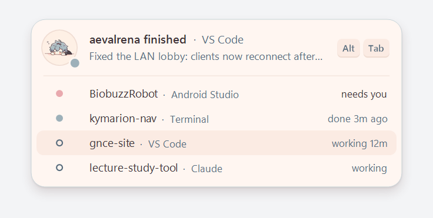

# Aevalsistant

A tray app for Windows, and a menu bar app for macOS, for people who run several AI coding agents
at once. It keeps the computer awake while any agent is working, and when one finishes or needs you,
a card drops from the top of the screen saying which one. Click the card, or press Alt+Tab
(Option-Tab on a Mac) while it is showing, to jump to that window.

## Download

**[Download Aevalsistant.exe](https://github.com/aevalmere/aevalsistant/releases/latest/download/Aevalsistant.exe)**
(Windows 10 or 11, about 170 KB). Other versions are on the [releases page](https://github.com/aevalmere/aevalsistant/releases).

Run it from wherever it downloaded. It copies itself to `%LOCALAPPDATA%\Aevalsistant`, starts from
there, and shows a card once it is in the tray. There is no installer and no admin prompt. Don't
use "Run as administrator": agents running normally can't reach an elevated copy, so it refuses
to start that way.

The exe is not code-signed yet, so the first run may show "Windows protected your PC". Choose
**More info**, then **Run anyway**. Each release lists the file's SHA-256 if you want to check it.

### Mac

**[Download Aevalsistant-mac.zip](https://github.com/aevalmere/aevalsistant/releases/latest/download/Aevalsistant-mac.zip)**
(macOS 13 Ventura or later, Apple silicon or Intel). It is a separate app with the same features,
built from `mac/`, and it ships in the same releases as the exe.

Open the zip, then open Aevalsistant. It moves itself into Applications (the one in your home folder
if you cannot write to `/Applications`), starts from there, and shows a card once its face is in the
menu bar. The app is signed but not notarized yet, so the first time macOS says it cannot check it
for malicious software. Choose **Done**, open **System Settings > Privacy & Security**, and click
**Open Anyway** next to Aevalsistant. You only do this once; updates install without asking.

On a MacBook, "Keep working with the lid closed" is on by default, and macOS only allows that for an
administrator. On the first run the app asks for your password once to add a rule that lets it turn
sleep off and on (`pmset disablesleep`) and nothing else. Cancel, and the setting turns itself off.

## Features

- A Windows power request keeps the PC from sleeping until the last agent stops, then lets go.
  Optionally it keeps the screen on too, or keeps a laptop working with the lid closed.
- The card's top row is the session that just changed. Under it is every other session with its
  state: needs you, done 3m ago, working 12m. Subagents, and sessions that another agent started,
  are listed under the session they belong to.
- Hover over the card to read the whole message; it drops down to show it and waits while the
  mouse is on it.
- Clicking a row focuses the terminal, editor, or app that session runs in. Alt+Tab while the card
  is showing jumps to the top one.
- Background work stays quiet: a subagent or a session started by another agent finishing does not
  pop a card, unless you turn that on. Anything that needs you still does.
- An optional soft chime, one for "finished" and one for "needs you", that stays quiet during
  presentations and full-screen games.
- The card never takes keyboard focus, is hidden from screenshots and screen sharing, and only
  counts down while you are at the keyboard.
- It updates itself from this repository's releases, and waits until no agent is working before
  it restarts.

## What it tracks

| Agent | How | Where it is configured | One-time step |
|---|---|---|---|
| Claude Code (terminal, VS Code, JetBrains, Claude desktop Code tab) | Hooks | `~/.claude/settings.json` | Restart open sessions once |
| Codex CLI and the Codex IDE extension | Hooks | `~/.codex/hooks.json` | In Codex, run `/hooks` once to trust them |
| Gemini CLI | Hooks | `~/.gemini/settings.json` | Restart open sessions once |
| GitHub Copilot CLI | Hooks | `~/.copilot/hooks/aevalsistant.json` | Restart open sessions once |
| Cursor (agent in the editor) | Hooks | `~/.cursor/hooks.json` | None |
| Windsurf (Cascade) | Hooks | `~/.codeium/windsurf/hooks.json` | None |
| OpenCode | Plugin | `~/.config/opencode/plugins/aevalsistant.js` | Restart OpenCode once |
| Claude desktop chat, ChatGPT desktop | Reads the app's Stop button through Windows accessibility | Nothing to configure | None |

Hooks are only added for agents whose config folder exists on this PC. Agents installed later are
picked up within 10 minutes. Every file is backed up once as `<name>.aevalsistant.bak` before the
first change, and other hooks in it are left alone.

Rows and notifications name the project folder, the agent when it is not Claude Code, and the app it
runs in: "rover needs you · Codex · Terminal", "site finished · Gemini CLI".

Chat apps have no hooks. When you switch away from Claude or ChatGPT while a reply is being written,
the app sees the reply's Stop button. It then checks every few seconds until the button is gone and
shows "Chat finished · Claude". Nothing is read while you are not waiting on a reply. If the reply
finishes while that app is in front, no notification is shown. Turn this off with "Watch Claude and
ChatGPT desktop chats" in Settings.

Not tracked:

- Cloud sessions of any agent, which run on the provider's servers.
- Chats in a browser tab.
- Background shell commands, which have no completion hook.
- Aider, which only has a "waiting for input" command and no start signal.
- Cline, whose hook format could not be confirmed.

## Tray menu and Settings

Left- or right-click the tray icon, or click the face in the Mac menu bar. The icon's eyes are open
while agents are working. The menu lists your sessions, with what each one started indented under
it; click one to jump to its window. Anything that needs your attention shows up there too,
followed by **Settings** and **Quit**.

Settings apply as soon as you change them. Options that depend on another one sit under it and
only appear while it is on. The Mac app starts with keep-awake fully on and the sound off:

| Setting | Windows | Mac | What it does |
|---|---|---|---|
| **Keep awake** | | | |
| Keep the PC (Mac) awake while agents work | On | On | Stops the computer from sleeping until the last agent stops. The screen can still turn off |
| &nbsp;&nbsp;Keep the screen on too | Off | On | Also stops the display from turning off |
| &nbsp;&nbsp;Keep working with the lid closed | Off | On | Laptops only. Lets the laptop keep working with the lid shut while agents work, puts things back after, and sleeps a minute after the agents finish if the lid is still shut. Windows sets the lid action to "Do nothing"; the Mac turns sleep off with `pmset` and asks for your password once |
| **Notifications** | | | |
| Show a card when an agent finishes | On | On | |
| &nbsp;&nbsp;Also when background agents finish | Off | Off | Subagents, sessions another agent started, and turns an agent takes on its own |
| Show a card when an agent needs you | On | On | Permission prompts and questions |
| &nbsp;&nbsp;Also when a background agent needs you | On | On | |
| Play a sound | On | Off | A soft chime with each card; buttons under it play each one |
| Expand the card on hover | On | On | Shows the whole message |
| Alt+Tab (Option-Tab) jumps to the agent while the card is up | On | On | |
| Card stays up | Normal | Normal | Short, Normal, or Long |
| **Agents** | | | |
| Connect coding agents | On | On | Adds or removes the hooks in the table above, with a switch for each agent found on this computer |
| List subagents under their session | On | On | In the card and the menu |
| Watch Claude and ChatGPT desktop chats | On | On | Notices replies finishing in the desktop chat apps. On a Mac this needs Accessibility access, which Settings has a button for |
| **General** | | | |
| Start with Windows (Open at login) | On | On | Starts the app when you sign in |
| Update automatically | On | On | Checks for a new release two minutes after start and every six hours |

Settings also has **Show a test notification**, **Check for updates**, links to the release notes
and the issue tracker, and **Remove from this PC** (**Remove from this Mac**).

## What it changes on your PC

- Copies itself to `%LOCALAPPDATA%\Aevalsistant\`, and keeps its settings there in `settings.ini`.
- Adds hook entries to the files in the table above, for agents that are installed.
- Adds a `HKCU\Software\Microsoft\Windows\CurrentVersion\Run` entry when "Start with Windows" is on.
- While agents work: a power request named "Aevalsistant: AI agents are running" (check with
  `powercfg /requests`). With "Stay awake with the lid closed" on, the lid action of the active power
  plan is set to "Do nothing" and restored when the last agent stops, or on the next start after a
  crash.

"Remove from this PC" in Settings undoes all of it, including the hooks in every agent's files.

On a Mac:

- Lives in `/Applications/Aevalsistant.app` (or `~/Applications`), and keeps its settings in
  `~/Library/Application Support/Aevalsistant/settings.ini`, next to the socket agents report to.
- Adds the same hook entries, with the app's path inside the bundle as the command.
- Adds itself to Login Items when "Open at login" is on.
- While agents work: a power assertion named "Aevalsistant: AI agents are running" (check with
  `pmset -g assertions`). With "Keep working with the lid closed" on, the file
  `/etc/sudoers.d/aevalsistant` lets your account run `pmset -a disablesleep 0` and `1` without a
  password, and the app turns sleep off while agents work and back on when the last one stops, or on
  the next start after a crash.

"Remove from this Mac" undoes all of it (it asks for your password again to delete the sudoers
rule) and moves the app to the Trash.

The only network traffic is the update check: a request to `api.github.com` for this repository's
latest release, and the download of a newer exe or app when there is one. Nothing about your
sessions, projects, or prompts leaves the computer.

## Updates

A newer release is downloaded to `%LOCALAPPDATA%\Aevalsistant\update\` and checked against the
SHA-256 that GitHub publishes for the file. Its version is read from the file itself. It is installed
the next time no agent is working, because restarting forgets which sessions are busy. After the
restart, a card says which version is now running.

To update by hand, run a newer exe. It replaces the installed copy the same way.

The Mac app does the same with `Aevalsistant-mac.zip`: it checks the zip against GitHub's SHA-256,
unpacks it into `~/Library/Application Support/Aevalsistant/update/`, checks the bundle's version and
signature, and opens it once no agent is working; the new copy replaces the one in Applications.

Version 1.1.0 and earlier have no updater. If yours has no "Check for updates" anywhere, download
the latest exe once and run it.

## Known limits

- Focus lands on the window, not on a specific terminal tab inside VS Code or Windows Terminal, and
  not on a specific chat inside the desktop app.
- Sessions that were already open when the hooks were installed or changed must be restarted once.
- The non-Claude agents were wired from each tool's hook documentation. If one of them does not show
  up, please [open an issue](https://github.com/aevalmere/aevalsistant/issues/new/choose) with the
  agent's version.
- On a Mac, clicking a session brings its app to the front. With Accessibility access (the same
  permission chat watching uses), it also raises the window whose title has the project's name;
  without it, the app's own front window comes up.
- The Mac app is signed ad hoc, not with a Developer ID, so macOS treats each update as a new app
  for Accessibility. After an update, turn Aevalsistant off and on again under Privacy & Security >
  Accessibility if chat watching stops.
- macOS 15 and later let screenshots and screen sharing that use ScreenCaptureKit see the card;
  earlier versions leave it out, as Windows does.

## Build from source

Needs the [.NET SDK](https://dotnet.microsoft.com/download) 8 or later. The app itself targets .NET
Framework 4.8, which ships with Windows 10 and 11, so the exe has no runtime to install.

    dotnet build -c Release
    dotnet build -c Release tests
    tests\bin\Release\net48\Aevalsistant.Tests.exe preview

The exe lands in `bin\Release\net48\Aevalsistant.exe`. The test run prints a pass count and writes
renders of the card to `preview\`. [docs/ARCHITECTURE.md](docs/ARCHITECTURE.md) explains how the
pieces fit, and [docs/DESIGN.md](docs/DESIGN.md) holds the visual rules.

The Mac app is Swift and AppKit with no dependencies, and builds on macOS 13 or later with Xcode or
the Command Line Tools:

    mac/build.sh
    mac/test.sh preview-mac
    mac/smoke.sh

`build.sh` puts a universal `Aevalsistant.app` and `Aevalsistant-mac.zip` in `mac/build/`, with the
version from `Aevalsistant.csproj`. `test.sh` runs the same checks as the Windows tests and writes
renders of the card and the Settings page to `preview-mac/`. `smoke.sh` starts the built app against
a scratch home folder and drives it with real hook calls. The checks that need no AppKit also run
under Swift on Linux.

## Releasing

1. Set `<Version>` in `Aevalsistant.csproj` to the new version.
2. Add a `## [x.y.z] - YYYY-MM-DD` section to the top of `CHANGELOG.md`.
3. Commit, then tag and push:

       git tag v1.3.0
       git push origin main v1.3.0

The [build workflow](.github/workflows/build.yml) builds and tests on Windows and on macOS, refuses
the tag if it does not match `<Version>` or the changelog, and publishes a release with two files,
`Aevalsistant.exe` and `Aevalsistant-mac.zip`. The changelog section becomes the release notes. Version numbers must go up: installed
copies only take a release newer than themselves, so a bad release is rolled back by publishing the
old code under a higher version.

## License

[MIT](LICENSE)
